<!-- ═══════════════════════════ HEADER ═══════════════════════════ -->
<p align="center">
  
</p>

<p align="center">
  
  
  
  
  
  
</p>

<br/>

<p align="center">
  
</p>

<p align="center">
  
</p>

<br/>

```ts
// engineer.config.ts
export default {
  role:        "Senior Full-Stack Developer",
  experience:  "5+ years",
  shipped:     "10+ production apps (web + iOS + Android)",
  focus:       ["SaaS", "Dashboards", "Fintech", "AI-powered apps"],
  ownership:   "architecture → build → deploy → optimize",
  languages:   { ukrainian: "native", english: "full professional" },
  status:      "open to remote 🌍",
} as const;
```

<br/>

## ⟢ stack.lock

> everything below has been used in real production, not just in tutorials

**Languages**

<p>
  
</p>

**Frontend**

<p>
  
</p>
<p>
  
  
  
  
  
  
  
  
  
  
</p>

**Mobile**

<p>
  
  
  
  
  
  
</p>

**Backend & APIs**

<p>
  
</p>
<p>
  
  
  
  
  
  
  
  
  
  
  
</p>

**Data & Caching**

<p>
  
</p>
<p>
  
  
  
</p>

**Cloud & DevOps**

<p>
  
</p>
<p>
  
  
  
  
  
  
</p>

**Testing & Quality**

<p>
  
</p>
<p>
  
  
  
  
  
  
</p>

**Integrations & Services**

<p>
  
  
  
  
  
  
</p>

**Tools & Workflow**

<p>
  
</p>
<p>
  
  
  
</p>

<br/>

## ⟢ git diff --stat impact

```diff
@@ performance @@
- initial page load      4.2s
+ initial page load      1.8s          (code splitting · lazy loading · asset optimization)
- frontend bundle        100%
+ frontend bundle        58%           (−42%)
- API response time      baseline
+ API response time      −35%          (query optimization · Redis caching)

@@ reliability @@
+ uptime                 99.5%         over 18 months on AWS + Docker CI/CD
- production bugs        baseline
+ production bugs        −30%          (code review standards · structured PR flow)
- deployment time        baseline
+ deployment time        −50%          (microservices migration)

@@ codebase @@
- 15,000+ lines of legacy JavaScript
+ 15,000+ lines of typed TypeScript with full test coverage
```

<br/>

## ⟢ things I've built

| | |
|---|---|
| 🤖 **AI SaaS platform** | automated reporting & data insights on top of the OpenAI API |
| ⚡ **High-load APIs** | REST + GraphQL on NestJS, 5,000+ requests/day |
| 📊 **Dashboards** | data visualization used by 1,000+ end users, accessible by design |
| 💳 **Payments** | Stripe flows powering monetization across 3+ client apps |
| 📱 **Mobile apps** | cross-platform React Native (CLI & Expo) for iOS and Android |
| 🛠 **Admin panels & portals** | Laravel + Vue.js internal tools and client portals |
| ☁️ **Infra** | Dockerized apps, CI/CD pipelines, AWS & Vercel deployments |

<br/>

## ⟢ how I work

```yaml
architecture:   scalable and well-structured over quick fixes
problems:       go deep until the real cause is found
code_review:    standards first, then speed
communication:  clear, honest, consistent progress
mode:           comfortable leading a team or shipping solo
```

<br/>

<p align="center">
  
  <a href="mailto:sasukoleksandr17@gmail.com"></a>
  <a href="https://www.linkedin.com/in/oleksandrsasiuk-full-stack-dev"></a>
</p>

<p align="center">
  
</p>
